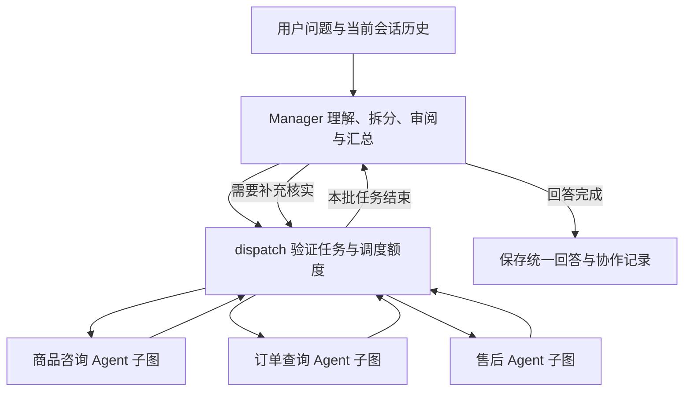

# Manager 与多 Agent 协作客服

当前客服使用 LangGraph 的 Manager 主图和三个专业子图；Manager 用模型工具调用自主决定分工、读取专业结果、继续调度或汇总回答。每个专业 Agent 自己执行模型—只读工具循环，并不是固定关键词分流。



- 商品 Agent：分类、商品搜索/详情、当前用户最近浏览、历史聊天搜索。
- 订单 Agent：本人订单列表/详情、历史聊天搜索。
- 售后 Agent：退款政策、本人订单列表/详情、历史聊天搜索。
- Manager：仅持有三个委派工具，不能直接查数据库，也不能扩展专业 Agent 的工具范围。

例如“最近看的耳机有什么特点，我的订单发货了吗，能否退款”：Manager 委派商品和订单 Agent 获取信息，再把订单编号交给售后 Agent 核实政策，最后统一回答；根据需要可重复委派同一 Agent。简单问候或当前会话中的已知偏好可直接回答，无需调用所有 Agent。

同一轮可派发多个任务，当前实现依次执行以共享预算、控制开销；这是分工协作，尚未并行执行。子 Agent 不互相递归调用，只通过 Manager 分享最多三个已完成任务的有限结果。前端可展开“本次服务分工”和“本次查询依据”，管理员也可查看协作分工。

## 配置

在 `backend/.env` 使用项目现有字段即可，不需要改字段名：

```dotenv
DS_API_KEY=你的DeepSeek密钥
DS_API_BASE=https://api.deepseek.com
DEEPSEEK=deepseek-flash
```

部署环境变量优先于 `.env`。修改密钥后重启后端开发服务；不要将密钥提交到版本库或放入前端。也兼容 `DEEPSEEK_API_KEY`，以及优先级更高的 `LLM_API_KEY/LLM_BASE_URL/LLM_MODEL`（后者仅用于支持同类工具协议的兼容服务）。

`BAIDU_QIANFAN_API_KEY`、`BAIDU_QIANFAN_BASE_URL`、`QIANWEN=qwen3-embedding-8b` 暂不使用。Embedding 模型不能直接替代聊天模型；本阶段查询用 SQL，不引入向量库。

DeepSeek 使用非思考模式的 Chat Completions 工具调用，不持久化或展示内部思考。模型调用失败会保留用户消息和失败状态，可在原会话重试；不会用模拟退款成功兜底。

## 工具与权限

| 工具 | 功能 |
| --- | --- |
| get_refund_policy | 查询自定义演示售后规则与所需资料，不执行退款 |
| list_product_categories | 查询分类编码和商品数 |
| search_products | 商品关键词、分类、币种、预算及库存过滤 |
| get_product_details | 商品介绍、参数、演示售价和库存 |
| list_my_orders | 当前账号订单分页和状态过滤 |
| get_my_order_details | 当前账号订单商品、金额、状态和物流 |
| get_my_browsing_history | 当前账号最近浏览的商品 |
| search_my_chat_history | 当前账号历史聊天关键词搜索 |

身份取自 JWT 和数据库，由后端闭包绑定到工具，参数里没有 `user_id`。多余参数会被拒绝，订单详情查询也必须匹配当前账号。每次查询使用独立只读数据库事务和 3 秒 SQL 超时，不接受任意 SQL。不提供下单、支付、取消、退款或后台修改工具。

完整电话和详细地址不传给模型，订单工具仅返回配送地区；完整收货资料引导用户在自己的订单详情查看。商品介绍和聊天内容作为数据处理，不能扩展工具权限。

## 历史与执行边界

- 自动带入当前会话最近 20 条已完成消息，当前提问只出现一次；上下文文本预算约 2 万字符。
- 对更早或其他会话的记忆，通过本人历史聊天搜索工具按需查询，不一次加载全部聊天。重试旧消息时不带入其后的对话。
- 默认整轮最多 16 次模型调用（Manager 与全部专业 Agent 共享）、24 次查询工具请求、6 次任务调度；Manager 最多调用 6 轮，每次专业任务最多调用模型 4 轮。单次模型请求超时不超过 20 秒，节点间检查共享的 90 秒预算；达到上限会保留可用结果并说明未完成部分。限制配置见 `app/agent/config.py` 的 `ModelSettings`。
- 工具查询结果有条数和体积上限，查询失败、无结果、达到上限分别向模型反馈，不伪造数据。
- 价格保留实际币种。演示销售设置与历史参考价分开，不自行换算汇率；参数筛选预算必须明确币种。
- 回复仍以一条 assistant 消息保存到 `chat_messages`，`agent_metadata.mode=manager_multi_agent`，记录模型名、各专业 Agent 的名称和完成状态、查询工具所属 Agent / 名称 / 状态、Manager 轮数、总模型调用数和是否受限。不保存委派任务全文、原始工具参数、专业报告全文或内部思考。原有历史消息继续可读，无需数据库迁移。
- 每个子图独立维护工具协议与中间消息，服务端通过闭包传递同一个已认证用户 ID；任务内容不能覆盖身份。Manager 和子图的只读边界不受模型输出影响。
- 某个专业 Agent 查询失败时向 Manager 返回安全的不可用状态；其他任务仍可继续。Manager 失败但已取得专业结果时返回明确标注未完成部分的结果；没有可用结果时说明无法核实，不伪造成功。人工接管时仍会停止当前回复落库并暂停后续 AI 调用。

## 运行与验证

更新已有数据库（可重复执行）：

```powershell
& backend/venv/Scripts/python.exe backend/scripts/init_activity.py
```

仅检查配置（不发模型请求）：

```powershell
& backend/venv/Scripts/python.exe backend/scripts/check_agent.py
```

真实接口商品查询检查（会产生模型调用费用，只查询公开商品）：

```powershell
& backend/venv/Scripts/python.exe backend/scripts/check_agent.py --live
```

`tests/test_agent.py` 使用脚本化模型与真实隔离数据库测试跨 Agent 协作、依赖结果传递、工具隔离、全局预算、专业 Agent 故障降级、权限和历史上下文，不调用付费 API。`tests/test_agent_live.py` 仅在 `AGENT_LIVE_TEST=1` 时运行，使用临时 schema 的虚构用户、订单和浏览记录测试真实 DeepSeek 三专业 Agent 协作、多轮查询，结束后删除该临时 schema。

官方依据：[DeepSeek 接口配置](https://api-docs.deepseek.com/)、[Tool Calls](https://api-docs.deepseek.com/guides/tool_calls/)、[思考模式兼容要求](https://api-docs.deepseek.com/guides/thinking_mode/)、[LangGraph 模型与工具循环](https://docs.langchain.com/oss/python/langgraph/quickstart)、[Supervisor / Subagents 协作模式](https://github.com/langchain-ai/docs/blob/main/src/oss/langchain/multi-agent/subagents.mdx)。

## 人工客服助手

管理员在 `/admin/support` 打开会话时，前端请求 `POST /api/admin/support-sessions/{id}/assistant`，生成 `summary`（聊天摘要）、`customer_needs`（用户诉求）、`suggested_reply`（建议回复）。使用同一套 DeepSeek 配置，以独立 LangGraph 的只读业务核实 → 结构化建议生成两节点执行，不走客户消息发送接口。

仅超级管理员可以调用。身份取自会话所属客户，由服务端绑定查询工具；不接受客户端 user_id 等参数。自动补充当前退款政策、关联订单和商品的只读信息，查询失败明确标记不可核实。取最近最多 50 条消息，单条最多 3000 字符、总聊天文本不超过 24000 字符，界面显示覆盖范围。

助手结果仅在当前页面展示，不写入聊天、不清除未读、不接管会话、不修改订单。点击“采用建议”才填入客服回复框，可编辑后由客服手动发送；已有草稿不会因生成/刷新建议而自动被替换。需要替换时按钮会明确提示。

详情接口的 `assist_version` 与建议的 `snapshot_version` 对应；有新消息、消息状态变化或接待状态变化时提示建议过期并暂停采用，可点击“重新生成”。生成失败时显示重试提示，原有手写回复仍可正常使用。同一会话的前端并发生成请求会合并，轮询不会反复调用模型。

建议和摘要暂不持久化，不需要数据库迁移。`tests/test_staff_assistant.py` 覆盖管理员权限、客户身份绑定、生成无写入、编辑后手动发送、上下文体积、过期版本和错误处理。
